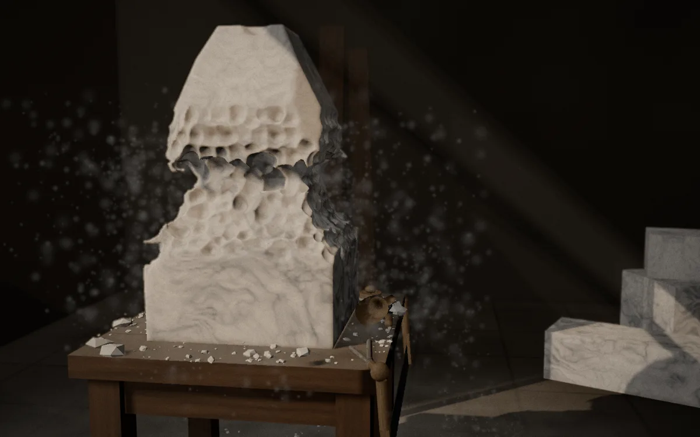
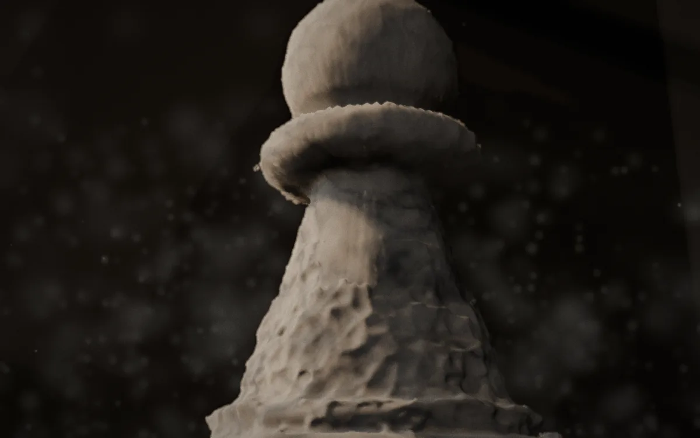
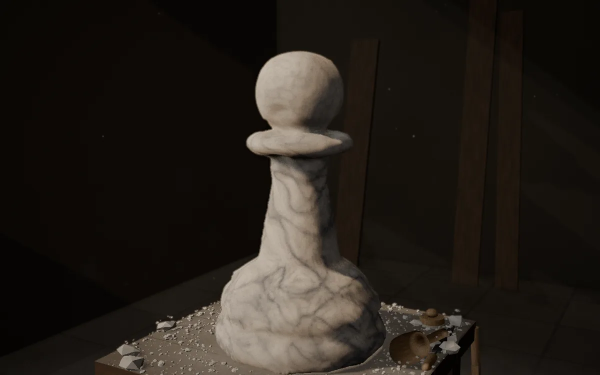

# Sculptor

An AI carves a block of virtual marble while you watch.

<p>
  
  
  
</p>

A chess pawn carved by Claude Opus, from the first rough-out to the finished piece.

You type a commission ("a chess pawn", "a sleeping cat"), choose Carrara or black Nero Marquina, and choose a model. The model then works a 60 × 100 × 60 cm block the way a carver would. It sketches on the block in charcoal, saws off the corners and roughs out with the point chisel, then refines with claw, flat chisel, drill, rasp and pad. Along the way it steps back to look from every side. It stops when it decides the piece is finished and signs the base. There is no undo: once stone comes off, it stays off.

The whole thing is staged like a short film. Light comes through one window, thin edges of marble glow, slabs fall and break, and dust hangs in the light. The sound is synthesised in the browser, and a camera director picks the shots. Every finished commission can be replayed with a scrubber and exported as an MP4 time-lapse, rendered in the browser with no model calls.

## How it works

**The stone is a voxel grid.** Each 0.4 cm voxel stores a signed distance to the surface, which comes to about 5.6 million voxels for the block. A strike subtracts a shape from the grid, and the mesh is rebuilt only in the 2 × 2 × 2 chunk bundles it touched. The kernel (`shared/sculpt/`) is plain TypeScript with no three.js or DOM, so the same code runs in a browser worker and in a headless Node bench.

**The model plans and a deterministic hand carves.** The model never places individual chisel marks. It issues passes such as "declare this form", "rough out to it with the point chisel", "detail this window from the front" or "rasp here". Code turns each pass into the hundreds of strikes you see. For heads, busts, human figures and animals the model declares a posed subject (pose, gesture, build, hair, expression), and a canon of anatomy (`anatomy.ts`, `figure.ts`) expands it into primitives the kernel can cut to.

**The model looks through a sculptor's eyes.** It gets neutral orthographic renders with a centimetre grid, close-ups of a window it chooses, and measurements computed by code, not taken from the picture. Optionally, out of sight, it works from a reference sheet drawn by an image model.

**Guards keep it honest.** A pass that would drop more than about a kilo of the declared form is refused before anything is cut. That guard exists because one early run took its own bust's head off with a detail pass from the top. A sculptor that tries to call a figure finished too early gets the commission quoted back to it.

**A sculpture is its log.** Every strike is recorded. That makes replays, scrubbing (from the nearest snapshot the worker kept) and film export reproducible without calling the model again.

**The film only listens.** Debris, dust, tools, sound and the camera react to strikes as they land and never touch the stone or its log. Nothing under `app/studio/` reads the wall clock, so film export can step the scene one frame at a time and encode it to H.264 with [mediabunny](https://github.com/Vanilagy/mediabunny). A 60-second film takes about 70 seconds to render on an M4 Pro.

## Running it

Node 22 and npm. Rendering needs a browser with WebGPU (recent Chrome or Edge). Elsewhere it falls back to WebGL 2 with a plainer look.

```bash
nvm use 22
npm install
cp .env.example .env    # AI_GATEWAY_API_KEY for live commissions; the studio and replays run without it
npm run dev             # http://localhost:3130
```

Model calls go through the [Vercel AI Gateway](https://vercel.com/ai-gateway), so one key covers Claude, GPT and Gemini. Each commission has a spend cap, set in `app/app.config.ts` and overridable with `?usd=`.

Useful URL flags:

| Flag | What it does |
|---|---|
| `?stone=nero` | Black marble on the banker |
| `?replay` | Lists saved commissions and study runs to watch; `/replay/<id>` opens one with the scrubber and film export |
| `?demo=1` | Carves a fixed demo (sawn corner, roughed, chiselled and rasped patches) with no model |
| `?hands=1` | Carve by hand with a tool palette |
| `?model=`, `?turns=`, `?usd=`, `?speed=` | A commission's settings for one page load |
| `?gl=1` | Forces the WebGL 2 backend |
| `?film=0` | The stone alone: no debris, tools, sound or camera director |

## Development

| Command | What it does |
|---|---|
| `npm run typecheck` | Nuxt's projects, then the bench and tests |
| `npm run lint` | ESLint (stylistic: no semicolons, 2 spaces) |
| `npm test` | `node --test` over the kernel, the agent loop, the canons and saved-log replays; no browser |
| `npm run shoot -- --gpu` | Screenshot from headed Chrome on WebGPU, with a guard against blank captures |
| `npm run shoot -- --gpu --lookbook` | Reshoots the 15 fixed look-book shots in [docs/look/](docs/look/README.md) |
| `npm run bench:sculpt -- --subject bust` | One headless commission into `.data/study/`; `--dry` runs a scripted sculptor with no key |
| `npm run bench:canon`, `npm run bench:poses` | The head, bust, figure and animal canons rendered on their own, no model |

The repo layout, every flag and the rules for working in the code (three.js on the WebGPU path, TSL materials, one post pipeline, no wall clock in the studio) are in [AGENTS.md](AGENTS.md). The plan, storyboard, research notes and the model study are in [internal_docs/20261108_ai_sculptor/](internal_docs/20261108_ai_sculptor/).

## Stack

Nuxt 4 (client-only), Nuxt UI 4, three.js `WebGPURenderer` with TSL node materials, Rapier for falling stone, Web Audio for sound, the Vercel AI SDK through the AI Gateway, and mediabunny for film export.

## Status

Built and run locally; not deployed. `sculptor` is a working title. By [Kyle Johnson](https://github.com/GKjohns) at Monument Labs.
